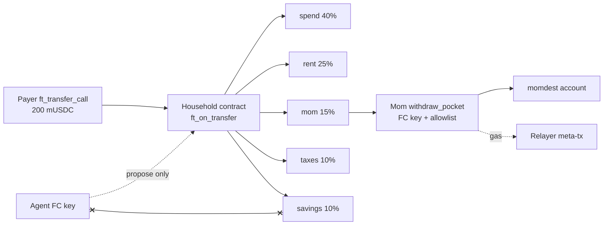

# Bolsillos ("pockets"): every USDC payment splits itself into household pockets

> **[Leer en español](README.es.md)** · Status: hackathon prototype · **NEAR testnet only** (faucet funds, mock USDC, no real value) · nothing on mainnet.

Bolsillos is a household money policy on NEAR. When a USDC payment arrives, the contract **atomically splits** it into named pockets (spend, rent, mom, taxes/monotributo, savings). Each pocket has its own **owner**, **allowlisted recipients** and optional **daily cap**. Family members spend from their pocket with a **function-call key**; a small **relayer** pays gas so they never buy NEAR. A household **agent** can read balances and propose rule changes (24h timelock) but **cannot** move funds outside policy.

**Hackathon tracks:** `realworld`, `open`, `security`.

**Q-015 disclosure.** This is an independent second project by the same person who submitted [Tune Up Research Desk](https://github.com/tuneupargentina/tuneup-research-desk). The two repos do not share code, accounts or contracts. Research Desk = on-chain SHA-256 receipts for research reports. Bolsillos = inbound USDC household split + scoped spend.

## Table of contents

- [Do X → see Y](#do-x--see-y)
- [How it works](#how-it-works)
- [Repository layout](#repository-layout)
- [Testnet deployment](#testnet-deployment)
- [NEAR features used](#near-features-used)
- [Quick start](#quick-start)
- [Mainnet path (documented only)](#mainnet-path-documented-only)
- [Honest limitations](#honest-limitations)
- [License](#license)

## Do X → see Y

| Do this | You should see |
|---|---|
| `cd contracts && cargo test` | **16 passed** |
| `cd mock-usdc && cargo test` | **3 passed** |
| Open `web/index.html` (or `python3 -m http.server 8080` in `web/`) | Live pocket balances from public testnet RPC; toggle **ES** for Rioplatense Spanish |
| Click “Pay 200 USDC” explorer link below | `EVENT_JSON` `split` with `amount` `200000000` and pocket credits 80/50/30/20/20 |
| Mom `withdraw_pocket` 10 → `b575-momdest.testnet` | `EVENT_JSON` `withdraw_pocket`; momdest `ft_balance_of` = `10000000` |
| Run `node relayer/demo-gasless.mjs` | Relayer submits Mom’s meta-tx; explorer shows relayer as signer, Mom as delegated sender |
| Agent calls `withdraw_pocket` on `savings` | Panic: `only pocket owner can withdraw` |
| Owner withdraws 20 from `savings` (cap 1) | Panic: `exceeds daily cap` |
| `bash scripts/e2e.sh` (needs local credentials) | Full storyline log under `pruebas/e2e-*.log` |

## How it works



1. Owner calls `set_pockets` once with basis-point shares that sum to **10000**.
2. Anyone sends the household mock USDC with `ft_transfer_call`. `ft_on_transfer` credits each pocket in **one** receipt (remainder dust → last pocket).
3. A pocket owner calls `withdraw_pocket(pocket_id, amount, recipient)`. Checks: caller is owner, recipient on allowlist, amount ≤ balance and ≤ remaining daily cap.
4. Relayer accepts only `SignedDelegate` whose `receiver_id` is the household contract, then pays gas.
5. Agent may call `propose_rule_change`; owner `apply_rule_change` after the timelock (configurable; demo uses a short value for tests).

## Repository layout

```
.
├── README.md · README.es.md · LICENSE · .gitignore · check_secretos.py
├── contracts/          # Rust near-sdk household (16 unit tests)
├── mock-usdc/          # NEP-141 mock USDC, 6 decimals + mint (3 unit tests)
├── res/                # bolsillos.wasm · mock_usdc.wasm (built artifacts)
├── relayer/            # Node meta-tx relayer gated to the household
├── agent/              # advise.mjs — read balances, suggest shares, --try-drain
├── web/                # static UI + EN/ES i18n (localStorage)
├── scripts/            # build.sh · e2e.sh
├── pruebas/            # RESULTADOS.md + e2e logs (*.log gitignored)
└── keys/               # accounts.env + key material (gitignored — never commit)
```

## Testnet deployment

| What | Value |
|---|---|
| Network | NEAR **testnet** · `https://rpc.testnet.near.org` |
| Mock USDC | [`musdc.bolsillos-575ed7c9.testnet`](https://testnet.nearblocks.io/address/musdc.bolsillos-575ed7c9.testnet) |
| Household | [`b575-house.testnet`](https://testnet.nearblocks.io/address/b575-house.testnet) |
| Payer / Mom / Momdest / Agent / Relayer | `b575-payer.testnet` · `b575-mom.testnet` · `b575-momdest.testnet` · `b575-agent.testnet` · `b575-relayer.testnet` |
| Deploy mock USDC | [`9SHKVc3N7ouXyAQ32L5B3TLjPsdEqR7U1SfUxTXfRRzk`](https://testnet.nearblocks.io/txns/9SHKVc3N7ouXyAQ32L5B3TLjPsdEqR7U1SfUxTXfRRzk) |
| Deploy household | [`9XR955fJB6UF1R2qM77PDDhHjwoKdweMQSbLZtWHEbBv`](https://testnet.nearblocks.io/txns/9XR955fJB6UF1R2qM77PDDhHjwoKdweMQSbLZtWHEbBv) |
| `set_pockets` 40/25/15/10/10 | [`BRWKhV5J4fqQMxNsFtQtLs8B7JiLMyfzGhuk7hBHYJ49`](https://testnet.nearblocks.io/txns/BRWKhV5J4fqQMxNsFtQtLs8B7JiLMyfzGhuk7hBHYJ49) |
| Pay 200 USDC (split) | [`4cV32ooGa8UxG7aaiXqRB4PLXE9cCVMbY1TdtrFUGdAF`](https://testnet.nearblocks.io/txns/4cV32ooGa8UxG7aaiXqRB4PLXE9cCVMbY1TdtrFUGdAF) |
| Mom withdraw 10 | [`EfJUW7hQahEB7BcqRvMUeqdRJ8jQrutDhEhZkmMKWRmA`](https://testnet.nearblocks.io/txns/EfJUW7hQahEB7BcqRvMUeqdRJ8jQrutDhEhZkmMKWRmA) |
| Mom gasless (relayer) | [`5Zx5SARwMeCwc17TtpMoePYNCsMBmobUpbwszfFXDr75`](https://testnet.nearblocks.io/txns/5Zx5SARwMeCwc17TtpMoePYNCsMBmobUpbwszfFXDr75) |

Pockets after the 200 USDC payment (before later withdraws): spend 80 · rent 50 · mom 30 · taxes 20 · savings 20 (all ×10⁶ atomic units).

## NEAR features used

| Feature | Where | Docs |
|---|---|---|
| NEP-141 `ft_transfer_call` / `ft_on_transfer` | mock USDC → household split | [NEP-141](https://github.com/near/NEPs/blob/master/neps/nep-0141.md) |
| Function-call access keys | Mom: `withdraw_pocket` only; Agent: `propose_rule_change` only | [Access keys](https://docs.near.org/protocol/accounts-contracts/access-keys) |
| Meta-transactions | `relayer/demo-gasless.mjs` + `server.mjs` gate | [Meta transactions](https://docs.near.org/web3-apps/tutorials/meta-transactions) |
| Named testnet accounts | faucet-created `b575-*.testnet` | [Accounts](https://docs.near.org/protocol/accounts-contracts/account-id) |
| NEP-297 events | `split`, `withdraw_pocket`, `propose_rule_change`, … | [NEP-297](https://github.com/near/NEPs/blob/master/neps/nep-0297.md) |
| near-sdk / cargo-near | Rust contracts | [near-sdk](https://docs.near.org/smart-contracts/what-is) |

## Quick start

### 1. Contract tests

```bash
cd contracts && cargo test
cd ../mock-usdc && cargo test
```

### 2. View the household (no keys)

```bash
near contract call-function as-read-only b575-house.testnet get_household \
  json-args '{}' network-config testnet now
```

### 3. Web UI locally

```bash
cd web && python3 -m http.server 8080
# open http://127.0.0.1:8080 — click ES for Spanish
```

### 4. Agent (read-only)

```bash
node agent/advise.mjs
# optional: node agent/advise.mjs --try-drain   # expected to fail
```

### 5. Gasless withdraw demo

Needs `keys/accounts.env` and `~/.near-credentials/testnet/*.json` from a prior faucet setup (not in git).

```bash
cd relayer && npm install && node demo-gasless.mjs
```

### 6. Full e2e

```bash
bash scripts/e2e.sh
```

### 7. Secrets scan

```bash
python3 check_secretos.py
```

## Mainnet path (documented only)

Not deployed. No `tuneup.near` seed was used. Intended path:

1. Swap mock USDC for Circle native USDC on NEAR: contract [`17208628f84f5d6ad33f0da3bbbeb27ffcb398eac501a31bd6ad2011e36133a1`](https://www.circle.com/multi-chain-usdc/near).
2. Inbound from other chains via [NEAR Intents 1Click](https://docs.near-intents.org/integration/distribution-channels/1click-api/quickstart) — call `https://1click.chaindefuser.com/v0/quote` with `"dry": true` first (Intents has **no testnet**, Q-007).
3. Keep the same pocket policy; point `token_id` at real USDC; run the relayer under a funded mainnet account with the same receiver gate.

## Honest limitations

- Demo uses **mock USDC**, not Circle USDC.
- Relayer is a **trusted** gas payer gated to one contract — not a decentralized paymaster.
- Timelock is **configurable** (short in tests/demo); production should use ≥ 24h.
- Web UI is a **viewer** plus storyline links; it does not embed a wallet signer yet.
- Pocket remainder dust goes to the **last** pocket by design.
- Member accounts here are top-level faucet accounts (subaccounts also work; same FC-key model).
- One household per deployed contract in this MVP (no factory yet).

## License

MIT · Copyright (c) 2026 Luis A. Santangelo / Tune Up
